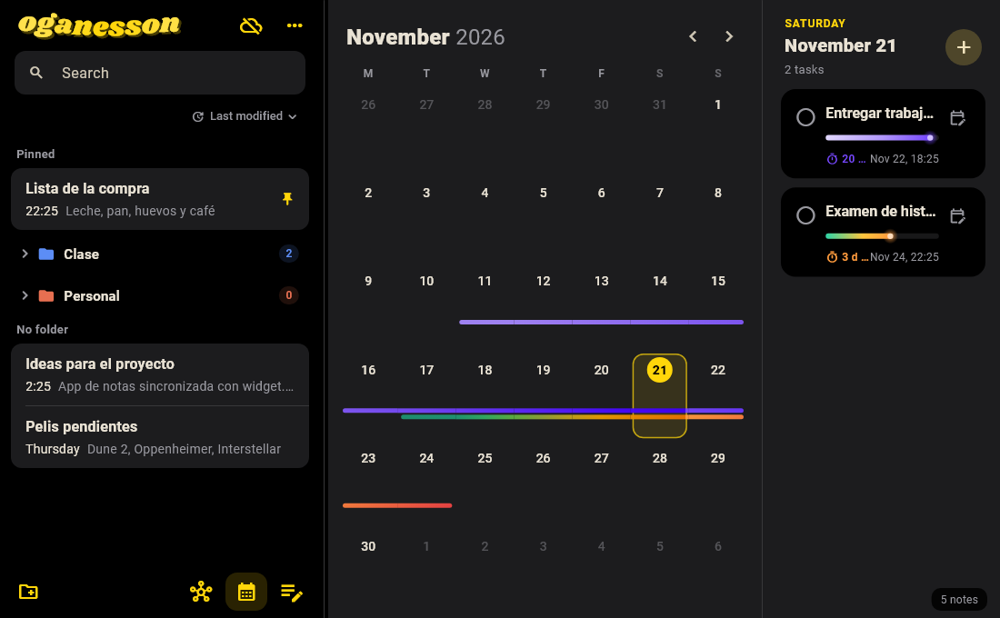
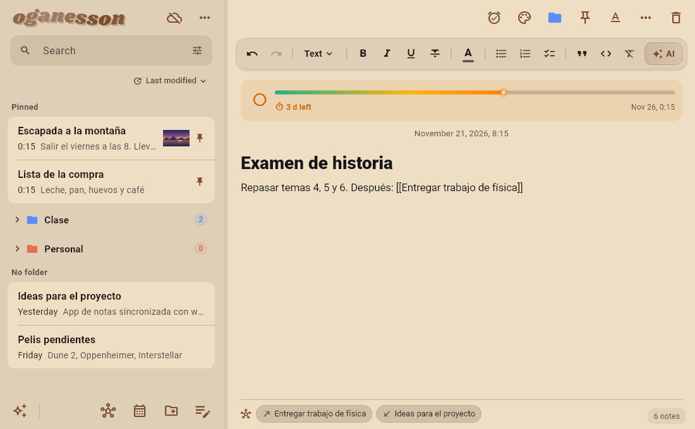

<p align="center">
  
</p>

<h1 align="center">Oganesson TakeNotes</h1>

<p align="center">
  Notes that live on your phone <b>and</b> your PC — synced in real time.<br>
  Folders, rich text, deadlines with reminders, a calendar and home-screen widgets.
</p>

<p align="center">
  <a href="https://github.com/rafaeldb22/Oganesson-TakeNotes/releases/latest/download/Oganesson-Setup.exe">
    
  </a>
  &nbsp;
  <a href="https://github.com/rafaeldb22/Oganesson-TakeNotes/releases/latest/download/Oganesson.apk">
    
  </a>
</p>

<p align="center">
  <a href="https://github.com/rafaeldb22/Oganesson-TakeNotes/releases/latest"></a>
  
  
  
</p>

<p align="center">
  
  
</p>

---

## Install

### Windows
1. Download **[Oganesson-Setup.exe](https://github.com/rafaeldb22/Oganesson-TakeNotes/releases/latest/download/Oganesson-Setup.exe)** and run it.
2. Windows SmartScreen may warn because the app is not code-signed: click **More info → Run anyway**.
3. It installs for your user only (no admin rights) and adds a Start menu entry. Uninstall from *Settings → Apps*.

Prefer no installer? Grab **Oganesson-Windows-portable.zip** from the [latest release](https://github.com/rafaeldb22/Oganesson-TakeNotes/releases/latest), unzip it and run `Oganesson.exe`.

### Android
1. Download **[Oganesson.apk](https://github.com/rafaeldb22/Oganesson-TakeNotes/releases/latest/download/Oganesson.apk)** on your phone and open it.
2. Allow installing apps from that source when Android asks (and choose *Install anyway* if Play Protect shows a notice).
3. New versions install on top of the old one — your notes stay in your account.

Sign in with the **same account** on every device and your notes sync automatically.

## Features

**Notes**
- iPhone-style list with pinned notes, search, swipe to delete and a two-panel layout on desktop.
- Rich text editor: titles, bold/italic/underline/strikethrough, bullet & numbered lists, checklists, quotes, code, text colour and highlight. New notes start with a big title line.
- Folders with name and colour; custom colour per note.
- Trash: deleted notes stay **3 days** before being removed for good (restore, delete forever, empty trash). Every delete can be undone for 3 seconds.

**Deadlines & calendar**
- Turn any note into a task with a start and a deadline, picked on a mini calendar with a time wheel.
- A "fuse" bar shows how much time is left, burning from mint to red (or in the note's own colour).
- Monthly calendar covering the current month, the 3 before and the 3 after, with a bar for every task and a resizable task panel.
- Reminders — *"Recordatorio: …"* — when **7 days, 3 days and 1 day** are left.

**Sync**
- Real-time sync between Android and Windows through Supabase; works offline and uploads changes when back online. Last edit wins.

**Look & feel**
- 10 colour themes, each with light and dark mode, animated theme switching.
- Animated retro title, smooth transitions and micro-interactions throughout.
- Windows: custom title bar (like Chrome), resizable panels that remember their width, minimum window size for a stable layout.
- Android: 2×2 quick-note widget and a 4×2 calendar widget with upcoming tasks.

## Build from source

**New PC?** One script installs everything (Git, Visual Studio 2022 C++ workload, Flutter, Claude Code), clones the repo and prepares the Windows project — run it in PowerShell (not as admin):

```powershell
powershell -ExecutionPolicy Bypass -File scripts/setup_dev_windows.ps1
```

Requirements: Flutter (stable, 3.50+), Git. For Windows builds: **Visual Studio 2022** with *Desktop development with C++* (MSVC 14.52 / VS 2026 cannot build the Windows notifications plugin yet).

```powershell
# Windows
./scripts/prepare_windows.ps1
flutter run -d windows
```

```bash
# Android (device or emulator connected)
bash scripts/prepare_android.sh
flutter run
```

`android/` and `windows/` are generated by the scripts with `flutter create`; the custom Android files (widgets, manifest) live in `platform/android/` and are copied on top.

Run with sample data and no account: `--dart-define=DEMO=true`.

### Backend
The app uses a Supabase project (URL and publishable key in `lib/config.dart`; access is protected by Row Level Security). To use your own project, run the SQL files in `supabase/migrations/` in order and replace the values in `lib/config.dart`.

## Project structure

```
lib/
  main.dart                   app start, Windows window setup, theming
  config.dart                 Supabase URL + publishable key
  models/note.dart            Note and Folder models
  data/notes_repository.dart  local cache, sync queue, realtime, trash
  data/reminders.dart         scheduled notifications (Android + Windows)
  data/widget_bridge.dart     data for the Android widgets
  ui/                         screens: list, editor, calendar, sheets, themes, title bar
platform/android/             Android widgets (Kotlin + XML) and manifest
supabase/migrations/          database schema, RLS policies and realtime
installer/oganesson.iss       Windows installer (Inno Setup)
.github/workflows/            CI: builds APK + installer and publishes releases
```

## Changelog

See [CHANGELOG.md](CHANGELOG.md).
