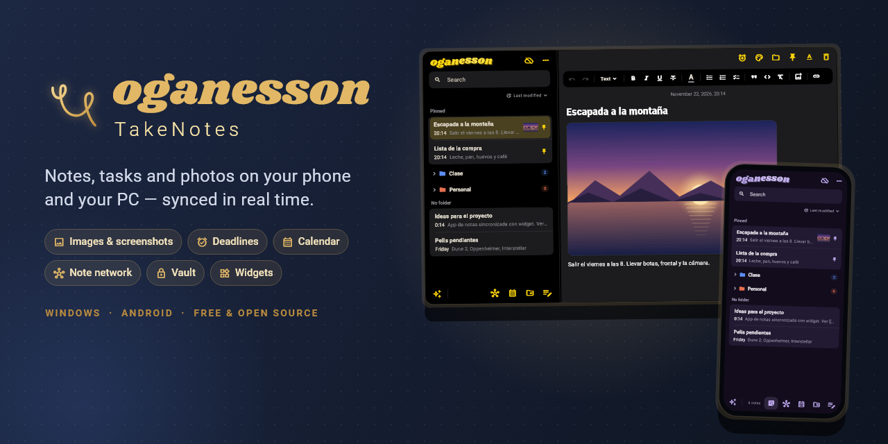
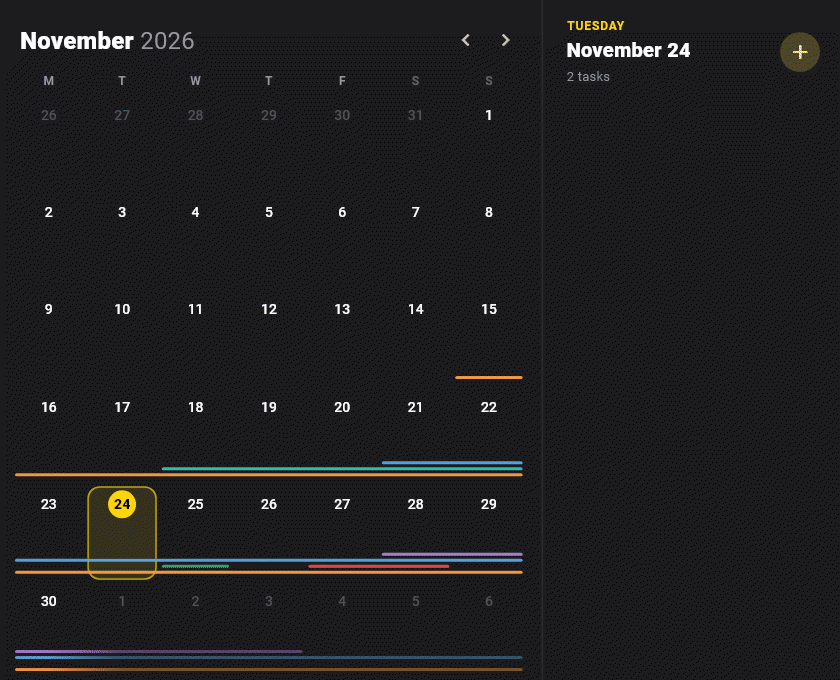
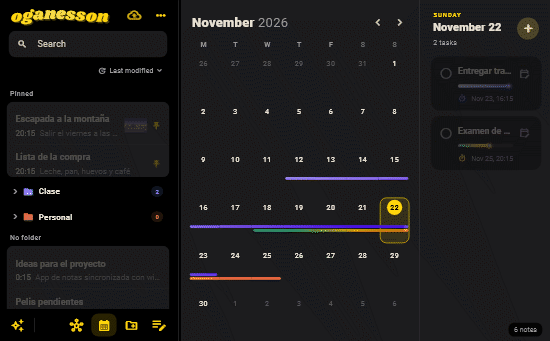
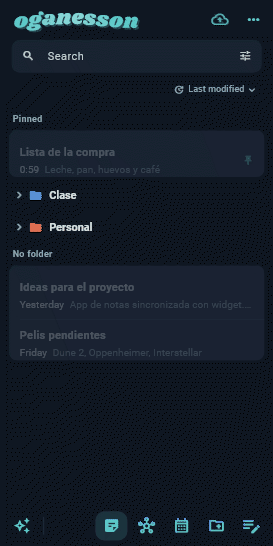
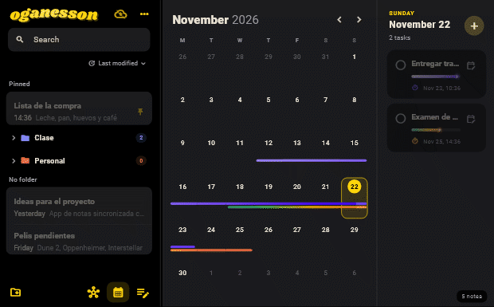
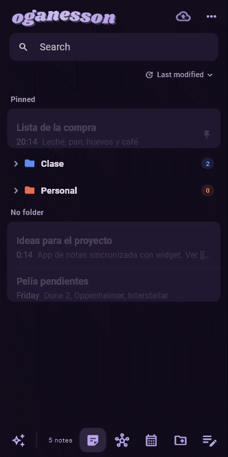
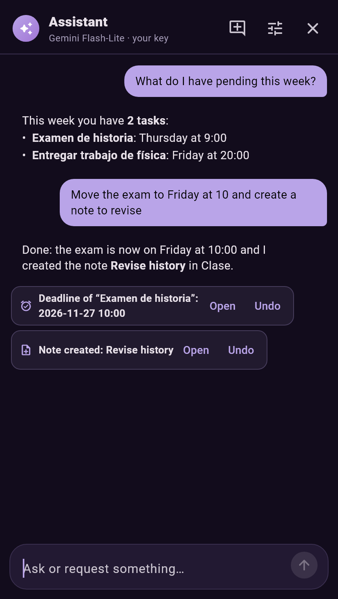

<p align="center">
  
</p>

<p align="center">
  Notes that live on your phone <b>and</b> your PC — synced in real time.<br>
  Folders, rich text, <b>photos and screenshots</b>, deadlines with reminders, a calendar, a note network, a Vault and home-screen widgets.<br>
  In Spanish and English.
</p>

<p align="center">
  <a href="https://github.com/rafaeldb22/Oganesson-TakeNotes/releases/latest/download/Oganesson-Setup.exe">
    
  </a>
  &nbsp;
  <a href="https://github.com/rafaeldb22/Oganesson-TakeNotes/releases/latest/download/Oganesson.apk">
    
  </a>
  &nbsp;
  <a href="https://github.com/rafaeldb22/Oganesson-TakeNotes/releases/latest/download/Oganesson-Windows-portable.zip">
    
  </a>
</p>

<p align="center">
  <a href="https://buymeacoffee.com/rafaeldb">
    
  </a>
</p>

<p align="center">
  <a href="https://github.com/rafaeldb22/Oganesson-TakeNotes/releases/latest"></a>
  
  
  
</p>

<p align="center">
  
  
</p>

## New in 3.1

<table>
  <tr>
    <td align="center" width="50%"><br><sub><b>Scribble to erase</b> — scribble over your ink with the pen and it disappears, with a small dot as the pointer</sub></td>
    <td align="center" width="50%"><br><sub><b>Cleaner calendar</b> — aligned, rounded lines that fade softly into the next month</sub></td>
  </tr>
</table>

- 🤖 **The AI asks before each change**, one at a time, so you can accept some and reject others.
- 📅 **All-day tasks** last until the end of the day, with no end time.
- ⏳ **The time-left banner** now sits at the bottom of the note.
- 🧠 **New in 3.2:** a faster, smarter AI that can also read your imported `.ics` calendars and plan around them.

## See it in action

<table>
  <tr>
    <td align="center" width="62%"><br><sub><b>Images</b> — paste screenshots with Ctrl+V, view them full screen with zoom, crop them and move them around the text</sub></td>
    <td align="center"><br><sub><b>Smooth notes</b> — only the note that comes or goes moves; swipe to delete or archive</sub></td>
  </tr>
  <tr>
    <td align="center"><br><sub><b>14 themes</b>, each with a soft light mode and a dark mode</sub><br><br><br><sub><b>Startup</b> — the logo draws itself</sub></td>
    <td align="center"><br><sub><b>On the phone</b> — notes, calendar and the note network</sub></td>
  </tr>
</table>

<sub>Everything above is recorded from the real app by `flutter test tool/record_gifs_test.dart` (demo notes, no mock-ups).</sub>

### How it works

| | |
|---|---|
| 📝 **Write** | Rich text with titles, lists, checklists, quotes, code, colours and highlight. New notes start with a big title line. |
| 🖼️ **Add images** | **Ctrl+V** pastes a screenshot (Win+Shift+S) or a copied image; drop files onto a note on Windows; gallery or camera on Android. Crop (free, 1:1, 4:3, 16:9, 3:4, rotate), move up/down or drag it between lines, copy, save. |
| ⏰ **Deadlines** | Turn a note into a task with a start and a deadline. A fuse bar burns down as time runs out, and you choose your reminders: daily, weekly, or 7, 3 and 1 days before, at the time you want. |
| 📅 **Calendar** | Month view with every task as a bar; tap a day to add one. |
| 🕸️ **Note network** | Link notes or create linked sub-notes, then explore them as a live graph. |
| 🔒 **Vault** | Notes behind a master password that locks itself after 5 minutes; reset it with your account password. |
| 🔄 **Sync** | Same account on every device, real-time sync through Supabase, works offline (images too) and uploads when back online. |
| ✨ **AI assistant** | Bring your own key — free **Gemini**, or **ChatGPT** / **Claude**: ask *"what's pending this week?"*, have it create notes, set deadlines, move notes to folders, mark tasks done… It asks before each change, every change can be undone, and it **never sees Vault notes**. |
| 📱 **Widgets** | Android home-screen widgets: calendar, tasks, next task with countdown, pinned notes and quick actions. |

---

## Install

### Windows
1. Download **[Oganesson-Setup.exe](https://github.com/rafaeldb22/Oganesson-TakeNotes/releases/latest/download/Oganesson-Setup.exe)** and run it.
2. Windows SmartScreen may warn because the app is not code-signed: click **More info → Run anyway**.
3. It installs for your user only (no admin rights) and adds a Start menu entry. Uninstall from *Settings → Apps*.

Prefer no installer? Grab **Oganesson-Windows-portable.zip** from the [latest release](https://github.com/rafaeldb22/Oganesson-TakeNotes/releases/latest), unzip it and run `Oganesson.exe`.

### Android
1. Download **[Oganesson.apk](https://github.com/rafaeldb22/Oganesson-TakeNotes/releases/latest/download/Oganesson.apk)** on your phone and open it.
2. Allow installing apps from that source when Android asks (and choose *Install anyway* if Play Protect shows a notice).
3. New versions install on top of the old one — your notes stay in your account.

Sign in with the **same account** on every device and your notes sync automatically.

## Features

**Notes**
- iPhone-style list with pinned notes, search and a two-panel layout on desktop (the calendar shows when no note is open).
- Swipe right to delete, swipe left to archive (both ask first); archived notes live in ⋯ → Archived.
- Drag notes up and down to reorder them or move them between folders.
- Rich text editor: titles, bold/italic/underline/strikethrough, bullet & numbered lists, checklists, quotes, code, text colour and highlight. New notes start with a big title line.
- Images: paste screenshots with **Ctrl+V**, drop image files onto a note (Windows) or add them from the gallery / camera (Android). Tap one to view it full screen with zoom (the controls are always visible); crop it, move it up or down, or drag it between lines like notes; copy, save or remove it. Notes with images show a thumbnail in the list. Photos are compressed and synced through your account (they upload later if you are offline).
- Collapsible folders inside the list (like Zen browser), with name and colour; custom colour per note.
- Sort by last modified, creation date or name.
- Trash: deleted notes stay **3 days** before being removed for good (restore, delete forever, empty trash). Every delete can be undone for 3 seconds.

**Note network**
- Right-click a note (long press on Android) to link it with other notes or create a linked sub-note.
- Graph view of all your notes and links: zoom, pan, drag nodes, hover to highlight neighbours, tap to open.
- Every note shows its links and backlinks.

**AI assistant (bring your own key)**
- Open it with the ✨ button (bottom left), ⋯ → *AI assistant* or **Ctrl+J**. Pick **Gemini** (free key from [Google AI Studio](https://aistudio.google.com/apikey)), **ChatGPT** ([OpenAI API key](https://platform.openai.com/api-keys), paid) or **Claude** ([Anthropic API key](https://console.anthropic.com/settings/keys), paid). Each key is stored encrypted on that device only, never uploaded.
- It can list and read your notes and tasks, create notes (with folder and deadline), add text, set or clear dates, mark tasks done, pin and move notes. It asks you before changing an existing note, one change at a time, and every change has an *Undo* button.
- **Vault notes are never sent to the AI.** Choose Gemini Flash-Lite (more free requests per day) or Gemini Flash (smarter, fewer free requests); the free plan's limits are shown in Google AI Studio and the app tells you clearly when you hit them.

<p align="center"></p>

**Vault**
- Notes behind a master password, in their own screen from the ⋯ menu (never in the normal lists or widgets).
- Locks itself after 5 minutes without use. Change the Vault password from ⋯ with the current one **or with your account password** (also if you forgot it).

**Completed & languages**
- Tasks completed more than 3 days ago move to *Completed* by themselves and are kept for 30 days.
- Spanish and English, switchable from ⋯ → Language.

**Deadlines & calendar**
- Turn any note into a task with a start and a deadline, picked on a mini calendar with a time wheel.
- A "fuse" bar shows how much time is left, burning from mint to red (or in the note's own colour).
- Monthly calendar covering the current month, the 3 before and the 3 after, with a bar for every task and a resizable task panel.
- Reminders — *"Recordatorio: …"* — when **7 days, 3 days and 1 day** are left.

**Sync**
- Real-time sync between Android and Windows through Supabase; works offline and uploads changes when back online. Last edit wins.

**Look & feel**
- 14 colour themes, each with a soft light mode and a dark mode, animated theme switching.
- Animated retro title, smooth transitions and micro-interactions throughout.
- Windows: clean custom title bar tinted with the theme colour, resizable panels that remember their width, minimum window size for a stable layout.
- Android widgets: quick note, calendar (2×2 / 4×2 / 4×4), tasks, next task with countdown, pinned notes and quick actions.

**Windows: always one shortcut away**
- Oganesson starts with Windows in the background and lives in the system tray; closing the window keeps it there (the first time it asks).
- **Ctrl+Alt+N** anywhere in Windows opens a new note. Turn *Open when Windows starts* on or off, or quit completely, from ⋯.

**Keyboard (Windows)**
- Ctrl+Alt+N quick note from anywhere · Ctrl+K command palette · Ctrl+N new note · Ctrl+J AI assistant · Ctrl+F search · Ctrl+click select several notes · Ctrl+1 / 2 / 3 notes, calendar, network · Ctrl+, theme · Esc close the note.
- Ctrl+V pastes a screenshot or copied image into the note · in the image viewer: Ctrl+C copy, Ctrl+S save, Esc close.

**Updates & support**
- The app checks GitHub Releases and installs new versions in one click (Windows installer / Android APK).
- Open source: if you like it, you can [buy me a coffee](https://buymeacoffee.com/rafaeldb) ☕

## Build from source

**New PC?** One script installs everything (Git, Visual Studio 2022 C++ workload, Flutter, Claude Code), clones the repo and prepares the Windows project — run it in PowerShell (not as admin):

```powershell
powershell -ExecutionPolicy Bypass -File scripts/setup_dev_windows.ps1
```

Requirements: Flutter (stable, 3.50+), Git. For Windows builds: **Visual Studio 2022** with *Desktop development with C++* (MSVC 14.52 / VS 2026 cannot build the Windows notifications plugin yet) and Windows **Developer Mode** enabled (`start ms-settings:developers`), which Flutter needs for plugin symlinks.

```powershell
# Windows
./scripts/prepare_windows.ps1
flutter run -d windows
```

```bash
# Android (device or emulator connected)
bash scripts/prepare_android.sh
flutter run
```

`android/` and `windows/` are generated by the scripts with `flutter create`; the custom Android files (widgets, manifest) live in `platform/android/` and are copied on top.

Run with sample data and no account: `--dart-define=DEMO=true`.

### Backend
The app uses a Supabase project (URL and publishable key in `lib/config.dart`; access is protected by Row Level Security). To use your own project, run the SQL files in `supabase/migrations/` in order and replace the values in `lib/config.dart`.

## Project structure

```
lib/
  main.dart                   app start, Windows window setup, theming
  config.dart                 Supabase URL + publishable key
  models/note.dart            Note and Folder models
  data/notes_repository.dart  local cache, sync queue, realtime, trash
  data/reminders.dart         scheduled notifications (Android + Windows)
  data/widget_bridge.dart     data for the Android widgets
  ui/                         screens: list, editor, calendar, sheets, themes, title bar
platform/android/             Android widgets (Kotlin + XML) and manifest
supabase/migrations/          database schema, RLS policies and realtime
installer/oganesson.iss       Windows installer (Inno Setup)
.github/workflows/            CI: builds APK + installer and publishes releases
```

## Changelog

See [CHANGELOG.md](CHANGELOG.md).
